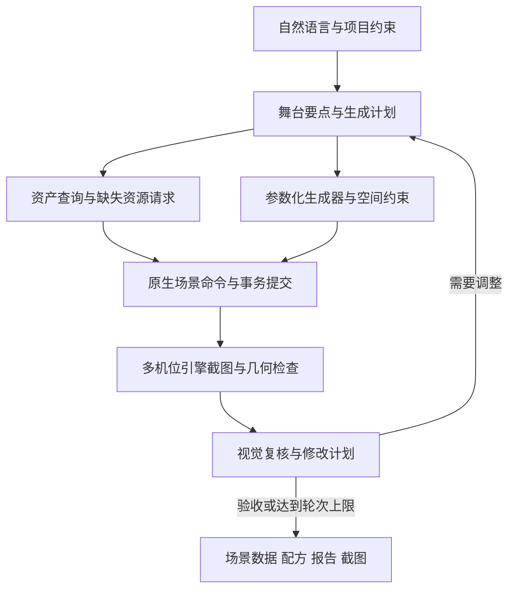

# 从一句话到可编辑世界：EVEngine 生成器与 AI 场景创作的技术拆解

“生成一个月光下的山间小镇，有通向古堡的道路，树林避开入口，广场留出战斗空间。”

这句话包含地形、道路、建筑、植被、光照和玩法约束。把它变成一张图，与把它变成可以进入、修改、保存和测试的游戏场景，是两种交付。

EVEngine 的做法，是让 AI 负责理解意图、选择工具和组织修改，让程序化生成器处理结构、空间约束与批量构造，再让真实场景和渲染结果参与验收。最终保留下来的应当是场景数据、生成配方、资源引用和修改记录，开发者还能继续编辑。

本文梳理截至 2026 年 11 月 12 日仓库中的生成器与相关工具，源码基线为 `7e09d026c0249a638958af4ffe8e2042d2a6977f`。下文介绍已有接口与实现设计；流程案例用于解释组合方法，不代表本文刚完成了一次完整的模型推理、引擎运行和多视角验收。

## 一、先看全貌：生成器已经覆盖哪些工作

如果只按“房屋生成器、树木生成器、地牢生成器”罗列名字，很容易忽略它们之间的关系。更有用的划分，是看每种工具拥有哪一层数据，以及它为下一层提供什么。

### 布局与地图：先决定世界的结构

二维地图与关卡生成包括 BSP 地牢、二维细胞洞穴，以及带布局和资产对象信息的 Roguelike 关卡。生成结果可以用语义地图表示，再由项目把地面、墙壁、门和道具角色映射到自己的素材。地图不是只能绑定一套图片的随机像素阵列。

城市布局使用 `urban.parcels` 和 `mesh.urban` 两类出口：前者保留街道、地块等语义，后者生成可显示的地块与街道网格。城市算法包含层级地块分割、街道接入和几何优化，考虑地块规则程度、可达性、网络连通、道路长度与交叉口等因素。它参考了地块与街道协同生成研究，但使用引擎内的 CPU C++ 实现，并存在离散化、求解器和道路密度上的工程取舍。

这种协同很关键：先把地块随机切完，再随意画路，容易留下无入口地块；先画一张好看的路网，也未必能得到可用的建筑占地。生成器需要让两者一起满足约束。

六边形地形与六边形球面又是不同的数据域。当前接口明确要求通过 `generateHexTerrain`、`generateHexSphere` 生成对应 bake，再交给 hexmap 消费。它们不能伪装成普通 `Grid2D` 的同一种输出。统一工具入口，并不意味着所有结果都必须压成同一种地图格式。

### 地形与体积：生成空间，而不只是表面图案

地形工具涵盖高度场、侵蚀、地貌分析、网格输出以及既有地形文件读取。侵蚀的详细结果能够保留磨蚀、沉积和高度变化等过程信息，为后续材质和植被规则提供依据。

例如，把侵蚀结果用于“哪里裸露岩石、哪里堆积泥土”的分布，比重新生成一张与地形无关的随机遮罩更容易保持一致。不过，工具提供过程数据，不代表项目已经自动完成了所有地貌到材质的映射。

三维洞穴使用骨架、洞室、三维标量场、表面演化、沉积与 Marching Cubes 提取，保留真实的体积结构。它与二维细胞洞穴是两套不同算法。二维洞穴适合地图连通与通行格，三维洞穴还要处理上下空间、岩壁形态和洞室关系。

独立的 `ScalarField3D` 也允许参数化体积编辑和网格提取。它可以服务洞穴，也可以成为其他体积造型的基础；不能把所有等值面造型都称为具有地质意义的洞穴模拟。

### 建筑与构件：从一个模型走向可修改的结构

建筑相关工具包括房屋、城堡、摩天楼，以及道路、桥梁和线性拼接结构。

房屋生成保留楼层、房间和组件语义，支持逐层准备、修改、发射并最终完成。城堡配方包含多层城墙、塔楼、真实门洞、主堡、墙顶步道与实体楼梯等构件。摩天楼、城区和道路示例则提供另一类建筑与街道表现入口。

线性构件包括栅栏、石墙、桥、长城、树篱、拒马，以及钢缆、铁链和麻绳。这里既有沿路径组织设施的问题，也有构件本身的几何问题。例如钢缆和麻绳通过多股螺旋构造，铁链通过交替椭圆环组成；某些整数扭转参数能够让单元接缝的相位闭合。

此外，内置原型建造套件提供 75 个基础三维模块，覆盖门窗、墙角、楼梯、坡道、围栏、地面、机关和标记物等。它们由程序直接生成顶点和索引，统一 Y-up、居中占地和落地原点。对于 AI 白盒搭建，这类规范比模型细节更重要：尺寸和原点一致，自动摆放才不必不断猜测偏移。

样条管道工具沿 Catmull–Rom 路径生成圆截面网格，支持控制点编辑、局部半径、开放或闭合路径和端盖。当前示例生成外表面，不自动生成带壁厚的内腔，也不解决自动布线、自交与碰撞。对象指向箭头则提供二维、三维和薄片等表达，适合关系可视化与引导；它生成 CPU 网格，不替调用者查找目标对象，也不自动成为 UI 控件。

### 自然物与散布：生成“长什么样”，也生成“长在哪里”

树木、灌木、岩石等生成器解决单体形态；PointSet、空间采样和过滤工具解决大范围分布。

树木支持不同的枝条生成策略。其中空间殖民方法让枝梢朝树冠吸引点生长，适合构造不规则冠形。叶片可以采用卡片、叶丛或较便宜的冠层表达。几何细节、叶丛数量和受光法线共同影响外观与成本，不能只看枝条数量。

森林看起来是否自然，还取决于点的位置、密度、坡度、与道路的距离以及实例之间的间隔。因此，“生成一棵树”和“生成一片可通行、不会堵门的森林”应当由不同层的工具协作。

### 表面与视觉：把几何变成可读的场景

程序化纹理与 PBR 配方涵盖无缝表面、木地板、瓷砖、钢缆、铁链、麻绳，以及木材、金属、橡胶、织物、塑料、钢、玻璃、纸、铝、生铁、水泥、涂漆和大理石等日常材质。

地板可以改变拼接布局、木色、缝隙、磨损和倒角；瓷砖可以调整图案、釉面和填缝。原型纹理另有尺寸引导、网格和定位点，便于白盒阶段检查尺度。程序化贴花提供污渍、锈蚀、裂纹等局部表面变化；云场、天空和相关环境工具则属于相邻的视觉生成能力。

这里需要划清一个常见误区：生成 albedo、normal、roughness、metallic、height、AO 六张图，不代表默认材质已经使用全部六个通道。当前文档说明默认 Material 可直接使用 albedo、normal、height 和粗糙度、金属度标量，其他贴图仍可能需要导出或接入自定义 shader。玻璃配方携带透射率和折射率，也不会自动让默认渲染器拥有完整折射效果。

## 二、共同的基础不是随机数，而是配方契约

这些工具能够组合，依靠的是一致的输入、输出、错误和生命周期约定。

脚本侧以 `eve.Procgen()` 为入口，参数包含 seed、尺寸及算法自己的字段。算法、网格、纹理和 PBR 配方提供 schema，暴露字段类型、默认值、范围、选项、分类与说明。项目可以用同一份元数据构造滑块、输入框和选择器，AI 也可以先查询这些约束再组织参数。

这样，“让建筑更高”就不必变成重写网格算法。调用者可以找到高度字段，检查范围，修改参数并重新生成。AI 能提出修改意图，具体哪些值合法，仍由工具契约决定。

当前生成与提交接口使用统一 Result 投影：`ok`、`code`、`status`、`diagnostics` 和 `value` 等字段。只有成功才读取值。失败不能通过“得到一个空对象，再去读另一个全局错误字符串”来拼凑协议。

参数的规范化也直接影响缓存正确性。整数 `1`、浮点 `1.0`、布尔 `true` 和字符串 `"1"` 不应意外碰撞；同一组参数也不应因为插入顺序不同就被当作不同配方。稳定且保留类型的参数表示，才能可靠地构造 build key。

seed 必须和算法版本、脚本配置一起保存。固定 seed 可以帮助复现，但不能单凭一个数字承诺跨平台浮点结果逐字节一致，也不能保证修改了算法之后仍生成完全相同的内容。

## 三、PointSet 把“自然分布”拆成可以检查的步骤

PointSet 的每个点不只拥有位置，还可以携带法线、完整旋转、缩放、局部包围盒、颜色、坡度、密度、独立 seed 和自定义属性。它是放置候选及其属性的载体，不是整个世界的替代品。

以树林为例，可以把工作拆成：

1. 在区域内生成规则或 Poisson 候选点。
2. 把点投射到高度场，取得地表高度与法线。
3. 按坡度过滤，移除不适合树木的陡坡。
4. 排除道路缓冲区、建筑占地和入口保留区。
5. 用自裁剪维持树木之间的最小间隔。
6. 按属性选择树种、缩放和朝向，再发布实例。

中间集合独立拥有数据，可以检查、复用或分支。发现入口被树挡住时，不必重写树木网格；首先检查道路排除带和建筑边界是否正确传入散布层。

道路、河流和设施也可以用折线或样条控制点表达。沿样条按连续间距采样，可以安排路灯、护栏等设施；与样条的距离过滤则能建立道路边缘带与禁放区。

随机性也需要分层。树木与岩石若共享一个不断消耗的随机流，调整岩石数量就可能改变整片树林。通过命名分支派生 seed，例如 `trees`、`rocks`、`lamps`，可以减小局部编辑对其他内容的扰动。

PointGraph 在此基础上提供无环数据流、子图、节点缓存和调试统计；编辑器使用通用 GraphDocument 的 `procgen.point` domain。纯脚本与节点图可以服务不同使用习惯，没有必要为了使用生成器而强迫每个项目先建立一张图。

## 四、让 AI 修改阶段，而不是接管每个体素

生成器完全封死，AI 只能反复换 seed；把所有内部循环交给 AI 写脚本，又容易失去性能和约束。阶段式生成提供了中间路线。

房屋流程中，脚本决定每层房间类型、尺寸和楼层掩码，可以在发射前用 GridGraph 修改楼层。原生层检查上层是否有支撑、楼梯柱是否保留、掩码是否有效、组件是否齐全。失败保留可修正的状态，而不是把半栋房子立即写进场景。

洞穴流程中，脚本组织骨架、场采样、表面演化和沉积顺序；原生层执行密集标量场和网格提取。沉积之后不再随意替换宿主场或继续让表面退缩，因为沉积物需要保持与岩壁的锚定关系。

AI 因而可以修改“增加一个洞室”“省略这一轮表面演化”“改变上层建筑轮廓”等制作策略，原生算法仍拥有密集计算和结构约束。脚本不会为每个体素进入一次虚拟机回调。

这也解释了为什么阶段不能直接创建渲染实体：先完成并验证生成结果，再进行上传和场景发布，才能避免用户看到一半旧内容、一半失败的新内容。

## 五、增量重建与事务，让生成结果适合反复修改

AI 创作往往需要多轮调整。若每次改一盏灯，都重建地形、路网、森林和所有贴图，流程很快就不可用。

当前管线提供系统级 build key、阶段缓存、节点缓存和事务式热重载。输入不变的阶段可以复用；变化只影响依赖它的分支。失败时保留上一份成功快照，成功后才推进 revision 并替换结果。

脚本生成器宿主在 VM 所属线程上同步执行，临时 context 只在当次调用有效。返回后继续持有它，并不意味着可以在后台任意调用。需要跨热重载保留的是脚本 URI、seed 与项目配置，瞬态会话应当重建。

运行时分区生成还涉及 PointId、cell revision、实例批次与清理队列。场景漏掉多个更新版本时，应使用完整快照追赶，不能把最后一份增量误当作全部变化。提供者暂时失败、场景重建或存档恢复，都需要明确的重新同步路径。

这些机制让“改一点、观察、撤回”成为可实施的工作流，但不意味着任意图实例都可以并发执行。所属线程、资源生命周期和点数预算仍然有效。

## 六、AI 场景生成：从描述到计划，再到权威场景

`creative-brain` 负责意图解析、资产匹配、布局策略和生成计划。它可以从描述中提取风格、地貌、时间、道路与植被规则，再从资产目录形成白名单并报告缺失资产。没有配置语言模型时，它提供确定性的关键词回退，方便基础流程和测试运行。

关键词回退不是语言模型已经完成复杂推理的证据。资产目录也是项目输入，不能把示例目录里的一组标签等同于所有项目资源已经被正确标注。

`story-scene-agent` 则把剧情需求组织成舞台要点，复用 creative-brain 与 scene-qc，串联搭台、拍摄和质检。引擎侧通过 Scene Director 和 MCP 提供场景修改、状态查询、机位生成与批量搭建等工具。

实际搭建状态由 native `SceneAuthoringDocumentTarget` 与 `SceneEditorSession` 拥有，脚本 kit 的 renderable cache 是投影。这个所有权关系避免 AI 在 Python 或脚本里另建一份自认为正确、却与引擎不同步的世界。

场景动作包括添加、移动、旋转、缩放、材质、光照和摄像机，也有接地、对齐、屏幕构图、保存、恢复、撤销与重做等能力。修改可以携带 `expectedRevision`，过期请求应被拒绝。

当前 Scene Director 支持的程序化 kind 有明确范围，例如树、岩石、灌木、摩天楼和若干线性构件。生成器模块里存在某项配方，不代表 Scene Director 已自动暴露它。新增类别需要项目适配与资源消费代码，不能靠 AI 猜一个 kind 名称。

## 七、缺少素材时，供给链与场景搭建分开推进

程序化几何很适合地形、建筑构件、植被变体和白盒模块。特定角色、雕像或叙事道具则可能需要外部模型或图像生成。

`asset-pipeline-agent` 提供需求解析、候选检索、缓存下载、Headless Blender 标准化、格式导出、入库和异步通知等环节。工具配置包含来源与许可证过滤，并为候选保留作者、出处和 attribution。具体使用仍应核对候选实际许可证及相应义务，白名单不能替代逐资产来源记录。

素材处理涉及坐标轴、轴心、法线、材质和纹理规范。只有“文件下载完成”，还不足以让它正确出现在场景里。候选处理失败时，编排层可以尝试下一项；最终失败也必须被报告，不能用占位物冒充目标资产已经取得。

SSUI 生成客户端是另一类供给接口：发现服务能力和配方、提交异步任务、轮询与取消、下载 PNG 并验证 SHA256。现有 Python 材质编辑原型区分候选预览与正式应用，并保留持久撤销记录；README 已指向优先用于运行时集成的 native 插件。

原型当前的 `mock.checker@1`、baseColor PNG 和独立材质文档边界必须保留。跑通它，不等于任意扩散配方、完整 PBR 或三维模型生成都已接入游戏场景。

NormalCrafter 面向序列帧法线，采用时序窗口和重叠融合来减少逐帧独立预测的不一致；它属于素材加工服务，不负责场景布局，也不能承诺任意输入绝无闪烁。Tile Pipeline 则负责扫描、透明边界分析、确定性打包和 `eve.tileset/1` 输出，让生成的二维素材带着 pivot、footprint、walkable、cost 等数据进入地图。当前它是可组合基础设施，不是已经完成的通用导入器 UI。

## 八、生成以后，AI 要能找到对象、看到结果

场景越来越大时，修改“门左边那个箱子”首先是对象识别问题。`scene-search` 从引擎取得真实快照，在独立 Python 进程执行 embedding 推理，再把向量发布给 C++ 索引。模型不在引擎帧循环里下载或执行。

语义相关性与空间关系也分开处理。调用者先把箱子、门解析成确切对象 ID，再传入 left-of、near、inside 等空间谓词。工具返回位置、分数和空间证据，供调用模型解释。向量检索使用近似最近邻，不保证全局精确 top-k；“inside”一类几何判定也不能替代真实碰撞和可见性。

这让 AI 能对已有场景做局部修改，而不是每次重新描述整个场景。但索引必须遵守快照、模型空间与会话约束，语义源变化后需要重新准备，不能把旧命中永久当作当前对象。

视觉验收由 scene-qc 组织多机位截图，融合场景几何信息、本地视觉筛查和需要时的远端 VLM 复核，再生成有限轮数的修复计划。固定参考图反馈还提供一个更窄、但更可解释的路径：在相同机位、曝光与尺寸下比较指定颜色前景的轮廓 IoU，改善才保留，否则恢复原生文档。

轮廓 IoU 检查的是指定前景与参考的匹配，不会自动理解任意图片里所有物体。多模型评分也不是数学意义上的“场景质量证明”。它更适合作为定位问题、筛选候选和留下复查证据的工具。

最终还应使用 `whitebox-playtest` 等工具检查输入、等待帧、截图与游戏断言。道路看起来连通，不代表角色真的走得过去；门洞存在，不代表碰撞体给角色留够了空间。

## 九、把这些能力组合成一个小镇，流程应该怎样走

回到开头的山间小镇。一个可控的制作顺序，是先把需求变成几项明确约束：古堡入口朝向、道路宽度、广场禁放范围、森林坡度上限、建筑数量与视觉预算。

第一轮只建白盒。地形提供高度与坡度；城市或项目布局规则提供地块与道路；原型模块检查入口、楼梯、视线与通行。AI 根据实际包围盒和场景状态修改位置，避免凭模型名称猜尺度。

第二轮加入生成内容。房屋和城堡用各自的结构生成器，树木与岩石用独立 seed 分支，PointSet 把它们投射到地面并避让道路与建筑。道路设施沿路径采样。这里需要项目脚本把多个结果域接起来，不应声称已有一个按钮自动装配了全部模块。

第三轮加入材质与叙事道具。地板和墙面优先用可参数化配方保持重复尺度一致，特殊道具进入资产供给流程。候选贴图先预览，确认后才应用到材质；异步任务的迟到结果不能覆盖更新的文档。

第四轮验收。入口机位检查古堡识别度，玩家机位检查遮挡与尺度，俯视机位检查路网与密度。发现广场太拥挤，就修改散布排除区；发现建筑立面太杂，就修改建筑或材质参数。每次尽量只重建受影响分支。

最后保存配方、seed、资源来源、场景文档和报告，运行白盒或玩法测试。AI 提出的布局不是最终权威，已经提交并通过实际验证的场景才是交付对象。

## 十、性能预算也应成为生成输入

生成器减少手工劳动，却不会让顶点、纹理和 draw call 免费。应在生成前限制点数、叶丛数量、构件细分和贴图分辨率，在生成后检查实例数量、网格规模、资源占用与帧时间。

生成结果需要缓存，大地图、树木和 PBR 图不应在每帧无条件重建。体积场快照与事务可能复制较大数据，应合并编辑，再执行提取和上传。运行时分区调度则要尊重预算与清理生命周期。

PointGraph 当前提供 Vulkan/WebGPU 的 Point Compute 路径，但现有 GPU kernel 的范围主要是 `transform`。其他节点继续使用 CPU；GPU 失败可以回退，并通过 backend 与 fallback reason 暴露真实执行情况。它不是已经把全部地形、房屋和洞穴算法迁移到 GPU 的证明。

同样，程序化输出适合实例化，并不代表任意场景都自动达到目标帧率。生成阶段与渲染阶段应分别测量，平均值、慢帧、资源峰值和动态编辑延迟都需要保留。

## 十一、当前能力最有价值的地方

这套工具已经具备的基础，是多类参数化生成器、带属性的空间数据与图执行、可编辑生成阶段、事务与版本约束、AI 计划编排、真实场景控制，以及视觉与玩法检查入口。

仍然需要项目负责的，是资产目录质量、多个领域结果之间的适配、玩法规则、目标设备预算和最终美术验收。模型服务是否可用、外部素材能否取得、某项输出是否已接入默认渲染器，也必须逐项确认。

对独立游戏开发者而言，这种组合的实际价值，是把大量重复构造工作交给生成器，把意图理解和工具协调交给 AI，同时保留开发者对场景结构、配方与最终结果的控制。一次生成之后还能解释、修改、回退和验证，创作流程才有继续迭代的基础。

## 源码与阅读入口

本文采用固定提交作为阅读基线，避免把后续更新混入当前结论：

- [程序化生成模块与配方契约](https://github.com/EVEngine/EVEngine/blob/7e09d026c0249a638958af4ffe8e2042d2a6977f/docs/usr/modules/procgen.md)
- [目标导向生成指南](https://github.com/EVEngine/EVEngine/blob/7e09d026c0249a638958af4ffe8e2042d2a6977f/docs/usr/modules/procgen/guides.md)
- [PointSet、PointGraph、缓存与运行时分区](https://github.com/EVEngine/EVEngine/blob/7e09d026c0249a638958af4ffe8e2042d2a6977f/docs/usr/modules/procgen/pointset-pipeline.md)
- [房屋与洞穴阶段式生成](https://github.com/EVEngine/EVEngine/blob/7e09d026c0249a638958af4ffe8e2042d2a6977f/docs/usr/modules/procgen/generation-stages.md)
- [样条管道示例](https://github.com/EVEngine/EVEngine/blob/7e09d026c0249a638958af4ffe8e2042d2a6977f/examples/pipe-generator/README.md)、[对象指向箭头](https://github.com/EVEngine/EVEngine/blob/7e09d026c0249a638958af4ffe8e2042d2a6977f/docs/usr/modules/procgen/arrows.md)、[日常材质配方](https://github.com/EVEngine/EVEngine/blob/7e09d026c0249a638958af4ffe8e2042d2a6977f/docs/usr/modules/procgen/everyday-materials.md)
- [AI 场景导演](https://github.com/EVEngine/EVEngine/blob/7e09d026c0249a638958af4ffe8e2042d2a6977f/docs/dev/AI场景导演.md)
- [Creative Brain](https://github.com/EVEngine/EVEngine/tree/7e09d026c0249a638958af4ffe8e2042d2a6977f/tools/creative-brain)、[Story Scene Agent](https://github.com/EVEngine/EVEngine/tree/7e09d026c0249a638958af4ffe8e2042d2a6977f/tools/story-scene-agent)、[Scene QC](https://github.com/EVEngine/EVEngine/tree/7e09d026c0249a638958af4ffe8e2042d2a6977f/tools/scene-qc-agent)
- [外部素材管线](https://github.com/EVEngine/EVEngine/tree/7e09d026c0249a638958af4ffe8e2042d2a6977f/tools/asset-pipeline-agent)、[场景语义查询](https://github.com/EVEngine/EVEngine/tree/7e09d026c0249a638958af4ffe8e2042d2a6977f/tools/scene-search)、[SSUI 客户端](https://github.com/EVEngine/EVEngine/tree/7e09d026c0249a638958af4ffe8e2042d2a6977f/tools/ssui-client)
- [NormalCrafter](https://github.com/EVEngine/EVEngine/tree/7e09d026c0249a638958af4ffe8e2042d2a6977f/tools/normal-crafter)、[Tile Pipeline](https://github.com/EVEngine/EVEngine/tree/7e09d026c0249a638958af4ffe8e2042d2a6977f/tools/tile-pipeline)、[白盒游玩测试](https://github.com/EVEngine/EVEngine/tree/7e09d026c0249a638958af4ffe8e2042d2a6977f/tools/whitebox-playtest)

本文由 AI 辅助整理；接口与能力依据上述仓库资料，未把文档中的示例、干跑输出或历史测试等同于本文新完成的端到端实测。
